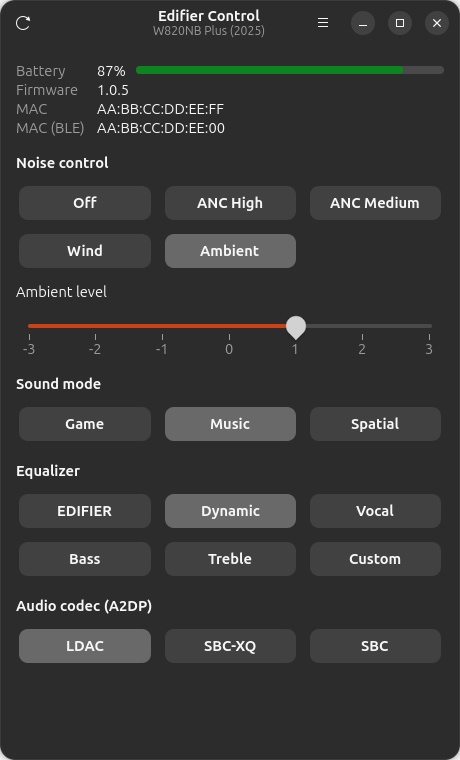
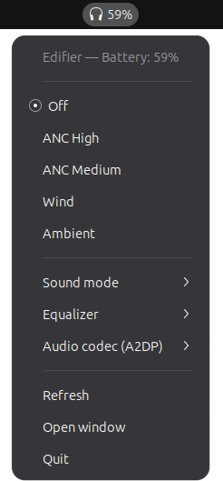

# Edifier Control — W820NB Plus (2025)

Control Edifier headphones from Ubuntu/Linux: CLI, GTK window and GNOME top-bar indicator.
Developed and tested on the Edifier W820NB Plus (2025); other models are not supported. Current version: 0.0.2, see [CHANGELOG.md](CHANGELOG.md).

The top-bar indicator:

Protocol based on [wh201906/mEDIFIER](https://github.com/wh201906/mEDIFIER) and the W820NB Plus fork [Klinkore/mEDIFIER](https://github.com/Klinkore/mEDIFIER).

## Requirements
Ubuntu (or another GNOME system) with BlueZ and PipeWire:

    sudo apt install bluez python3-gi gir1.2-gtk-4.0 gir1.2-adw-1 gir1.2-dbusmenu-glib-0.4

The headphones must be paired, switched on and connected to this PC.

## Install
The Debian package is attached to each [GitHub release](https://github.com/mechanig/edifier-control/releases):

    wget https://github.com/mechanig/edifier-control/releases/download/v0.0.2/edifier-control_0.0.2_all.deb
    sudo apt install --reinstall ./edifier-control_0.0.2_all.deb

To build the package yourself, run `packaging/build-deb.sh`; it writes `dist/edifier-control_<version>_all.deb`.
`dist/` is not tracked in git, the finished package belongs to the releases.

Or install for the current user only, without root:

    ./install.sh

## The application
`edifier-control-gui` (or "Edifier Control" in the app menu) is one program: a GTK4/libadwaita window and, in the
top bar, an icon with the battery level and a menu with the same controls. Closing the window hides it to the
icon; "Open window" or launching the app again brings it back, "Quit" in the icon menu ends the program.

- Window: firmware, MAC and battery, noise mode with ambient level, sound mode, equaliser preset and A2DP codec.
  Ukrainian and English (system locale; the language menu is behind the "..." button in the header).
- Icon: needs a panel that shows status notifier icons (GNOME: the AppIndicator extension, enabled by default on
  Ubuntu; KDE and others show them natively). Without such a panel, closing the window quits the program.
- `edifier-control-gui --background` starts only the icon. To do that at every login, copy
  `edifier-control-background.desktop` into `~/.config/autostart/` (or run `./install.sh --autostart`).

## Usage
    edifier-control normal | anc | anc-medium | wind | ambient | cycle
    edifier-control ambient-level -3..3
    edifier-control status | battery
    edifier-control audio game|music|spatial
    edifier-control eq edifier|dynamic|vocal|bass|treble|custom
    edifier-control codec [ldac|sbc-xq|sbc]   # A2DP codec, chosen by the PC via PipeWire

Headphones must be on and connected to this PC. If the `EDIFIER BLE` device is not
known to BlueZ the tool scans for 8 seconds. Set `EDIFIER_BLE_MAC` to pick a specific device.
Close Edifier Connect on other devices first, it may hold the BLE link.

## Protocol notes
- Packet: `AA EC cmd 00 len payload sum8`; replies: `BB EC cmd status len payload sum8`.
- Each command is first written as an ASCII hex string, then as raw bytes 100 ms later
  (characteristic `48090002-1a48-11e9-ab14-d663bd873d93`, notifications on `…0001`).
- Noise mode: cmd `C1`, payload `B5 <mode>`: `A0` off, `A4` strong ANC, `A7` medium, `A6` wind, `A1` ambient.
- Ambient level: `C1 B5 A1 <A0+offset>`, offsets for -3..3 are `4 1 0 3 2 13 12`.
- Status: cmd `CC`; battery: cmd `D0` (payload byte XOR `A5`).
- Sound mode: cmd `09` set / `08` read, `A4` game, `A5` music, `A7` spatial. Spatial disables the equaliser.
- Equaliser: cmd `C4` set / `D5` read, `A5` EDIFIER, `A4` dynamic, `A7` vocal, `A6` bass, `A1` treble, `A0` custom.
- Firmware: cmd `C6`, three bytes each XOR `A5`.
- The headphones ack a write before applying it, so writes are verified by reading the value back.

## Layout
- `edifier-control` — the CLI; all Bluetooth/PipeWire logic. Commands are serialised with a lock because the headphones have one BLE link.
- `edifier-control-gui` — the application: window, top-bar icon and one shared `edifier_common.Backend` that calls the CLI.
- `edifier_common.py` — the control table and the CLI backend; `edifier_panel.py` — the icon's menu; `edifier_indicator.py` — the status notifier protocol (no GTK); `edifier_i18n.py` — translations; `locales/` — language files.

## Tests
    python3 -m unittest discover -s tests     # no headphones needed: protocol framing, arguments, translations
    python3 tests/smoke.py                    # real headphones: runs every command and restores the previous state

The panel test needs a desktop session with a status notifier host and is skipped otherwise.

## License
MIT, see [LICENSE](LICENSE).
